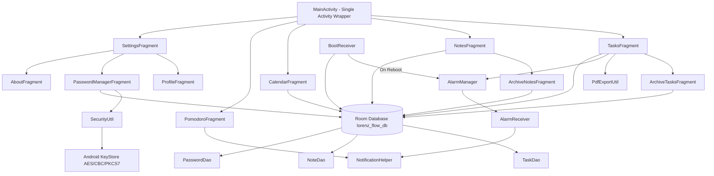

# Lorenz Flow ⚡

Lorenz Flow is a comprehensive, premium productivity and security companion for Android. Designed to streamline your daily workflow, the app combines task management, color-coded notes, a calendar planner, a Pomodoro focus timer, and a hardware-encrypted password vault into a single, cohesive experience.

Built with **Java**, **Room Database (SQLite)**, and **Material Design 3**, Lorenz Flow is designed for offline-first reliability, high performance, and robust security.

---

## 📱 Features Breakdown

### 1. Task & Deadline Manager
*   **Dynamic Task Management:** Create, edit, delete, and share tasks.
*   **Archiving System:** Move tasks to a dedicated Archive section to declutter your list without losing your history, with restore and clear-all operations.
*   **Categorization:** Label tasks using pre-defined categories with visually distinct badges:
    *   *Work, Personal, School, Wellness, Urgent, General*.
*   **Sorting Options:** Sort active tasks by *Upcoming Deadline* (default), *Newest First*, or *Oldest First*.
*   **Swipe Gestures:** Swipe-to-delete gesture using `ItemTouchHelper` with an instant snackbar notification containing a functional **Undo** mechanism.
*   **Completed Tasks Drawer:** Collapsible completed section showcasing task counts and a one-tap option to permanently purge all completed tasks.
*   **PDF Report Exporting:** Generates an A4 PDF document containing all active tasks and deadlines, styled and structured dynamically via graphics drawing canvas and exported directly to your device's `Documents` folder.

### 2. Rich Text Notes
*   **Grid Presentation:** Rendered in a responsive 2-column staggered grid layout.
*   **Color Customization:** Dynamic theme-aware palette selection to assign custom colors to notes, which adapt smoothly to dark and light modes.
*   **Manual Reordering:** Drag-and-drop notes in any direction to custom-arrange them. Layout positions are saved instantly in the background.
*   **Long-Press Menu:** Quick actions to Archive or Delete note cards directly.

### 3. Calendar Planner
*   **Visual Planner:** Integrated datepicker calendar widget showing due tasks.
*   **Due Date Filtering:** Selecting any date instantly queries the database to show all tasks scheduled for completion on that exact day.
*   **Direct Modifications:** Edit, complete, delete, or share tasks straight from the calendar list.

### 4. Pomodoro Focus Timer
*   **Multiple Modes:** Supports *Focus Session* (25 min default), *Short Break* (5 min default), and *Long Break* (15 min default).
*   **Custom Durations:** Adjust session lengths to fit your personal workflow.
*   **Visual Indicators:** Circular progress indicators tracking elapsed time percentage, colored dynamically according to the active mode.
*   **Alert & Vibration Alarms:** Triggers continuous ringing and system vibration when a session ends, complemented by high-priority push notifications.
*   **Smart Auto-Dismiss:** Overlay control dialog allowing users to shut off alarms, with a 15-second automatic termination fail-safe to prevent battery drain.

### 5. Hardware-Encrypted Password Manager
*   **Credential Vault:** Store and manage login credentials (accounts, usernames, and passwords) securely in a local database.
*   **Search Filter:** Instantly filter your saved credentials by website title or username.
*   **Secure Password Generator:** Generate strong, random passwords (16-characters, mixing uppercase, lowercase, numbers, and special symbols) using cryptographically secure algorithms.
*   **Biometric/Device Lock Integration:** Authenticates access using Android's system lock (Fingerprint, Face, PIN, or Pattern) via `KeyguardManager`.
*   **Custom Master PIN Fallback:** If the device has no secure lock set up, the app falls back to a custom 4-digit Master PIN, hashed securely with SHA-256.
*   **State-of-the-Art Encryption:** Passwords are never stored in plain text. They are encrypted using **AES/CBC/PKCS7Padding** with a hardware-backed key generated in Android's KeyStore Provider. Unique, randomized Initialization Vectors (IV) are generated and stored alongside each entry to prevent cryptographic pattern attacks.

### 6. Profile & Customization
*   **Custom Persona:** Personalize the app with your name, bio, and custom avatar.
*   **Persistent Offline Media:** Avatars are imported using modern Activity Contracts and copied locally into the app's private directory (`filesDir`) as `profile_pic.jpg`, resolving URI permission-loss issues and ensuring avatars render offline.
*   **Theme Control:** Supports Light mode, Dark mode, and automatic System-following behavior.

---

## 🛠️ Tech Stack & Architecture



### 1. Architecture Pattern
*   **Single-Activity Architecture:** The application uses a single main activity container (`MainActivity`) with sub-fragments switched in and out of the view hierarchy, keeping navigation transitions smooth and memory footprint low.
*   **View Binding:** Direct layout element references via generated binding classes, eliminating `findViewById` boilerplate and preventing null pointer errors during fragment transitions.
*   **Multithreading:** Database transactions and heavy tasks (such as PDF generation, photo importing, or password calculations) are run off the main UI thread using `Executors.newSingleThreadExecutor()` to prevent UI stuttering or ANR (App Not Responding) dialogs.

### 2. Database & Data Storage (Room ORM)
*   **Room Database Framework:** Abstracts raw SQLite operations into clean compile-time verified queries.
*   **Schema Schema Version:** Current Database Version is **4**.
*   **Safe Migrations:** Implements structured `Migration` scripts to safely update schemas between releases. The transition from **v3 to v4** adds the `archived` column (integers representing boolean states) to `tasks` and `notes` tables dynamically without erasing existing user data.

### 3. Alarm Scheduling & System Receivers
*   **Exact Timers:** Schedules task reminders using Android's `AlarmManager` (`setExactAndAllowWhileIdle`) targeted at the precise epoch millisecond of the deadline.
*   **Push Notifications:** Alerts are built via `NotificationCompat.Builder` using high-priority notification channels, ensuring reminders break through system battery optimizations.
*   **Boot Survivability:** Registers a `BootReceiver` listening for `android.intent.action.BOOT_COMPLETED`. Upon device reboot, it retrieves all incomplete tasks with future deadlines in a background thread and automatically registers new exact alarms in the system OS.

---

## 🔒 Security Implementation (Password Manager)

Lorenz Flow features an offline credential vault that operates under zero-trust principles:

1.  **Hardware-Backed Key Generation:**
    On first launch of the password manager, the app requests the system's `AndroidKeyStore` provider to generate a secret key using the standard Advanced Encryption Standard (AES) protocol. The key generation parameter specification is locked to blocks of CBC and PKCS7 padding.
2.  **Symmetric Encryption:**
    When saving a credential, the plaintext password is encrypted using the key stored in the hardware module. The algorithm returns the ciphertext and the randomly generated Initialization Vector (IV).
3.  **Encrypted Insertion:**
    The Room database only receives and stores the account title, username, ciphertext (base64 encoded), and the IV (base64 encoded). The plaintext password is never cached in local memory or written to disk.
4.  **Hardware Decryption:**
    To display a password, the system requests authorization, retrieves the ciphertext and IV from SQLite, loads the key from the hardware-backed keystore, initializes the Cipher object in Decrypt Mode with the IV, and decrypts the string on demand.

---

## 📋 Requirements & Dependencies

To compile and run this project, your environment must satisfy the following criteria:

### System & Build Requirements
*   **Java Development Kit (JDK):** Version 17
*   **Gradle Build System:** Gradle Version `9.5.0`
*   **Android Gradle Plugin (AGP):** Version `9.3.3`
*   **Android SDK Platforms:** Compile SDK version `34`, Target SDK version `34`
*   **Minimum Target Support:** Min SDK version `26` (Android 8.0 Oreo and above)

### Key Core Dependencies (`app/build.gradle`)
*   `androidx.appcompat:appcompat:1.6.1` — Backward-compatible action bar and theme support.
*   `com.google.android.material:material:1.11.0` — Material Design 3 interactive UI widgets.
*   `androidx.room:room-runtime:2.6.1` — Room local object-relational mapping database.
*   `androidx.room:room-compiler:2.6.1` — Room annotation processor for database compilation.
*   `androidx.recyclerview:recyclerview:1.3.2` — Memory-efficient list displays.
*   `androidx.constraintlayout:constraintlayout:2.1.4` — Flat, responsive UI layouts.

---

## 🚀 Setup & Execution Guide

Follow these steps to set up, build, and run the Lorenz Flow project on your machine:

### 1. Import Project
1.  Download or clone the project repository.
2.  Open **Android Studio** (Koala or newer recommended).
3.  Select **File > Open** (or **Open an Existing Project** on the welcome screen).
4.  Navigate to the root directory `lorenzFlow` and click **OK**.

### 2. Configure SDK Locations
If Android Studio doesn't automatically locate your Android SDK, create a file named `local.properties` in the root folder of the project (if it doesn't already exist) and specify your SDK path:
```properties
sdk.dir=C\:\\Users\\YourUsername\\AppData\\Local\\Android\\Sdk
```
*(Replace `YourUsername` with your actual Windows account user folder name).*

### 3. Sync Gradle
1.  Wait for Android Studio to initialize.
2.  Click the **Sync Project with Gradle Files** button (represented by an elephant with a circular arrow icon in the toolbar, or select **File > Sync Project with Gradle Files**).
3.  Ensure your internet connection is active so Gradle can fetch the Room ORM and Material library components.

### 4. Build and Run
#### Via Android Studio (Recommended):
1.  Connect your physical Android device via USB (with **Developer Options** and **USB Debugging** enabled) or launch an Android Virtual Device (AVD) Emulator (Targeting API level 26 to 34).
2.  Select `app` from the run configuration dropdown in the top toolbar.
3.  Click the green **Run** button (Play icon, or press `Shift + F10`).
4.  The application will compile and install on your target device automatically.

#### Via Command Line (Gradle Wrapper):
Open a terminal in the project root directory and execute:
```powershell
# Compile the debug APK
.\gradlew assembleDebug

# Install and run on the connected device/emulator
.\gradlew installDebug
```
*The compiled APK file will be located at:*
`app/build/outputs/apk/debug/app-debug.apk`

---

## 🔒 Permission Requirements

The application will prompt for the following system permissions as needed:
*   `android.permission.POST_NOTIFICATIONS` — Required on Android 13+ (API 33+) to push task deadline alerts and Pomodoro completion notifications.
*   `android.permission.SCHEDULE_EXACT_ALARM` & `android.permission.USE_EXACT_ALARM` — Required to launch high-accuracy timer operations and exact calendar task alerts.
*   `android.permission.RECEIVE_BOOT_COMPLETED` — Required to restore exact deadline alarms automatically after a device reboot.
*   `android.permission.VIBRATE` — Allows the Pomodoro timer to vibrate when sessions expire.
*   `android.permission.WRITE_EXTERNAL_STORAGE` (Max SDK version 28) — Required only on older versions of Android to save exported task PDFs into the shared `Documents` directory. On newer versions, it utilizes Scoped Storage (`MediaStore`) without requiring explicit permission.

---

## 👨‍💻 Developer & Credits

*   **Developer:** Jun Lorenz C. Masangcay
*   **Role:** Android Developer & Creator
*   **Institution:** 3rd Year Computer Engineering Student at Batangas State University, The National Engineering University (Alangilan Campus)
*   **Contact Info:**
    *   📧 Email: [junlorenzmasangcay@gmail.com](mailto:junlorenzmasangcay@gmail.com)
    *   🌐 Facebook Profile: [Jun Lorenz C. Masangcay](https://www.facebook.com/lorenshie/)
